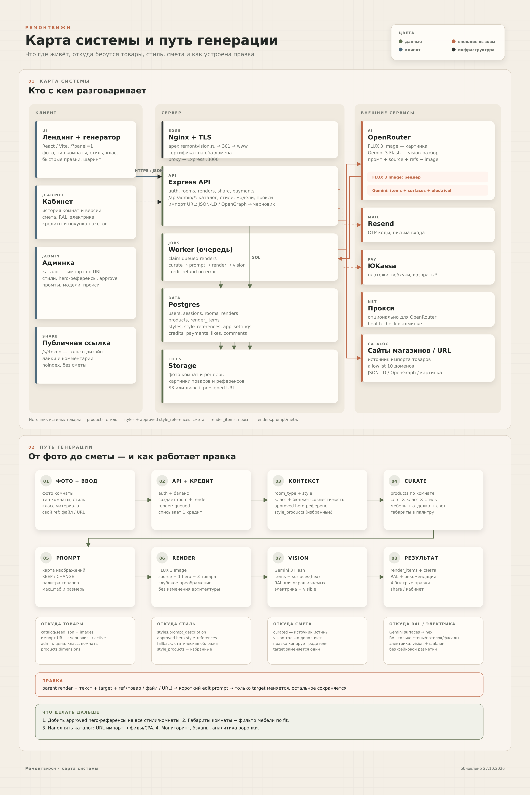

# ремонтвижн

AI-сервис редизайна интерьера по фото: визуализация комнаты, подбор материалов и товаров, смета и ссылки на товары.

**Прод:** https://www.remontvision.ru  
**Репозиторий:** https://github.com/oblacko/remontvision (private)  
**Документация для LLM:** [llms.txt](llms.txt) · [llms-full.txt](llms-full.txt) · [AGENTS.md](AGENTS.md)

---

## Статус на 2026-10-28

| Блок | Состояние |
|---|---|
| Генерация по фото | Работает: FLUX 3 Image, 1K, aspect auto |
| Vision-разбор | Работает: Gemini 3 Flash |
| Стили и room types | 10 стилей, 12 типов комнат |
| Hero-референсы стилей | 120 сгенерировано, 26 approved (пилот 5 стилей × 6 комнат) |
| Каталог | **Демо-каталог**: 100 активных товаров, **0 с реальным URL** |
| Импорт товаров | По одному URL и списком до 20 ссылок, с quality checks |
| Смета и RAL | Работают; RAL только для окрашиваемых поверхностей |
| Правки | Точечные, с референсом товара/файла/URL |
| Очистка комнаты | При выключенной мебели: FLUX 3 Image Klein, 1K, auto; настройки в админке |
| Шаринг | `/s/:token`, лайки, комментарии |
| Платежи | ЮKassa включена, возвраты выключены |
| Админка | Пользователи, кредиты, пакеты, стили, промт, логи, модели, прокси, каталог |
| Мобильный редактор `/app` | Старый монолитный интерфейс, не в новом стиле |

> **Главное ограничение запуска:** реальные заказы пока невозможны, потому что у товаров нет реальных URL. Демо-товары нужны для проверки дизайна, стилей и сметы. Пока не импортированы реальные товары с URL, кнопка ведёт в поиск, а не на страницу товара.

---

## Что умеет

1. Пользователь загружает фото комнаты, выбирает тип комнаты, стиль или свой референс, класс материалов.
2. Если мебель не сохраняем — сначала очищаем комнату до пустого каркаса, затем делаем дизайн с сохранением архитектуры, камеры и пропорций.
3. Vision-разбор достаёт материалы, поверхности, электрику и подсказки для правок.
4. Смета собирается из товаров каталога, подобранных под комнату, класс и стиль.
5. Пользователь может точечно править дизайн: заменить люстру, пол, светильник, текстиль — с референсом.
6. Результат можно скачать, открыть в кабинете или поделиться публичной ссылкой.

Подробно: [docs/GENERATION.md](docs/GENERATION.md).

---

## Быстрый старт

Требуется Node.js ≥ 20.6.

```bash
cp .env.example .env          # заполните OPENROUTER_API_KEY и ADMIN_KEY
docker compose up -d db       # Postgres на 127.0.0.1:5434
npm install
npm start                     # http://localhost:3000
```

Без `OPENROUTER_API_KEY` приложение стартует в **mock-режиме**: рендер заменяется демо-картинкой, расходов нет.

Сборка нового фронтенда:

```bash
cd web
npm install
npm run build                 # web/dist → раздаётся Express
```

Тесты:

```bash
npm test
```

Подробно: [AGENTS.md](AGENTS.md), [docs/OPERATIONS.md](docs/OPERATIONS.md).

---

## Архитектура



- [docs/ARCHITECTURE.md](docs/ARCHITECTURE.md) — компоненты, данные, деплой.
- [docs/GENERATION.md](docs/GENERATION.md) — путь генерации, промт, правки.
- [docs/CATALOG.md](docs/CATALOG.md) — каталог, товары, стили, импорт.
- [docs/ADMIN.md](docs/ADMIN.md) — админка.
- [docs/PROMPT-RULES.md](docs/PROMPT-RULES.md) — правила промта.
- [docs/API.md](docs/API.md) — API.
- [docs/OPERATIONS.md](docs/OPERATIONS.md) — прод, деплой, эксплуатация.
- [docs/ROADMAP.md](docs/ROADMAP.md) — планы и запуск.
- [docs/DECISIONS.md](docs/DECISIONS.md) — ключевые решения и почему так.
- [docs/HISTORY.md](docs/HISTORY.md) — хронология изменений.

---

## Стек

| Слой | Технологии |
|---|---|
| Backend | Node 20, Express, pg, multer, sharp |
| Frontend | React 19, Vite, TypeScript, Tailwind-подобные классы |
| БД | PostgreSQL 16 |
| Очередь | Postgres + воркер `src/jobs.js` |
| Файлы | диск или S3 (`src/storage.js`) |
| AI | OpenRouter: FLUX 3 Image, FLUX 3 Image Klein (cleanup), Gemini 3 Flash |
| Почта | Resend / SMTP |
| Платежи | ЮKassa |
| Инфраструктура | Docker Compose, Nginx, Let's Encrypt, GitHub Actions |

---

## Структура

```text
app/
  src/
    server.js          HTTP API, статика, auth, admin, share, payments
    jobs.js            воркер генерации
    openrouter.js      image/vision провайдер, промт, матчинг
    promptconfig.js    редактируемые правила промта (админка)
    roomtypes.js       типы комнат, слоты, keep/change, электрика
    curate.js          подбор товаров, референсы
    catalogseed.js     идемпотентный сид каталога
    stylerefseed.js    идемпотентный сид hero-референсов
    db.js              pg pool, миграции, SQL-запросы
    modelconfig.js     выбранные модели/разрешение/aspect
    modelcaps.js       возможности моделей
    productimport.js   импорт товара по URL
    remoteimage.js     безопасная загрузка картинок по URL
    proxy.js           прокси для OpenRouter
    storage.js         диск/S3
    payments.js        ЮKassa, кредиты
    receipts.js        чеки
    legal.js           документы/акцепты
  web/src/             React-приложение
  catalog/seed.json    демо-каталог
  public/catalog/      картинки демо-каталога
  public/style-refs/   hero-референсы стилей
  style-refs/seed.json сид референсов стилей
  migrations/          SQL-миграции 001–020
  docs/                документация
  test/                node:test
```

---

## Для LLM и агентов

- [llms.txt](llms.txt) — короткая карта проекта для LLM.
- [llms-full.txt](llms-full.txt) — полный контекст одним файлом.
- [AGENTS.md](AGENTS.md) — правила работы с репозиторием, команды, подводные камни.
- [docs/HISTORY.md](docs/HISTORY.md) — что и когда менялось.

При изменении кода обновляйте:
1. `docs/HISTORY.md` — что сделано.
2. Соответствующий документ в `docs/`.
3. `llms.txt` / `llms-full.txt` при изменении архитектуры или статуса.

---

## Лицензия и данные

Репозиторий private. Секреты (`.env`, ключи OpenRouter, ЮKassa, Resend, пароль прокси, `ADMIN_KEY`) **не коммитятся**. В документации используются только placeholder-значения.
