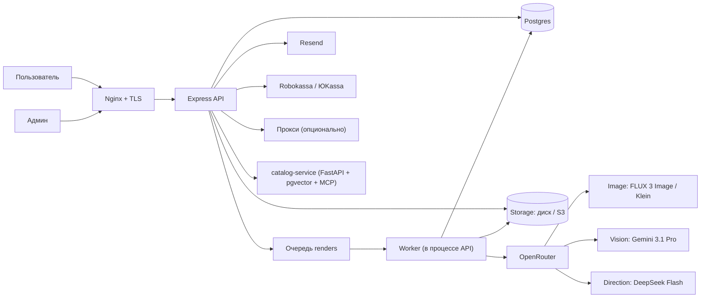
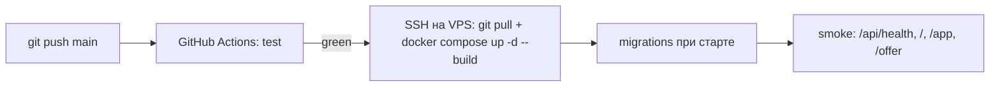

# Архитектура

Карта системы: [architecture.png](architecture.png) · [architecture.svg](architecture.svg).

## Верхнеуровневая схема

## Компоненты

| Компонент | Ответственность | Код |
|---|---|---|
| Nginx | TLS, HSTS, проксирование на `127.0.0.1:3000`, apex → www | конфиг на VPS |
| Express API | auth, комнаты, рендеры, админка, шаринг, платежи, статика | `src/server.js` |
| Worker | claim/lease, `processRender`, стадии, refund | `src/jobs.js` |
| Очередь | `renders` + lease/`claimed_by`, `WORKER_CONCURRENCY` | `src/db.js`, `src/jobs.js` |
| Image-слот | глобальная сериализация image-вызовов | `src/imageslot.js` |
| Direction | один vision-вызов арт-директора + `room_analysis` | `src/artdirector.js`, `src/roomanalysis.js`, `src/variability.js` |
| Postgres | пользователи, комнаты, рендеры, товары, стили, кредиты, платежи | `src/db.js`, `migrations/` |
| Storage | фото, рендеры, картинки товаров/референсов | `src/storage.js` |
| OpenRouter | image, vision, direction | `src/openrouter.js`, `src/openrouteragent.js` |
| Resend/SMTP | OTP и письма | `src/auth.js`, `src/mailer.js` |
| Платежи | Robokassa/ЮKassa, вебхуки, возвраты | `src/payments.js`, `src/robokassa.js` |
| Подбор товаров | MCP/catalog-service (текущий путь) | `src/visionagent.js`, `src/catalogclient.js`, `catalog-service/` |
| Legacy procurement | Yandex-путь, **не подключён** | `src/procurement*.js` |
| Search Lab | внутренний R&D-стенд | `src/search*.js`, `web/src/components/Search*.tsx` |
| React | лендинг, генератор, кабинет, админка, шаринг | `web/src/` |

## Потоки

### Создание генерации

1. `POST /api/rooms` (multipart): фото, до 8 пар `{style, concept}`, тип комнаты, класс, флаги.
2. Проверяются auth, кредиты, rate limit; модель/разрешение.
3. В одной транзакции: `rooms` + N × `renders(status=queued)`, списание за каждый вариант.
4. Воркер забирает рендер через `FOR UPDATE SKIP LOCKED`, ставит lease 5 минут и `claimed_by`.
5. `processRender` собирает контекст (vision, direction из кэша, cleanup при необходимости) и вызывает OpenRouter.
6. Результат — в Storage, анализ — в `renders.analysis`, стоимость — в `cost_usd`.
7. UI поллит `GET /api/rooms/:id` до `done`/`error`; прогресс «N из 8» по рендерам.

### Аренда и восстановление

- Heartbeat продлевает lease каждые 30 секунд.
- `requeueProcessing` возвращает в очередь только истёкшие lease.
- Reaper раз в 5 минут: queued старше 24 часов **или** processing дольше 60 минут → error + refund.
- Завершение/heartbeat проверяют `claimed_by`: воркер, потерявший lease, не перезаписывает результат.

### Правка

`POST /api/rooms/:id/iterate` создаёт дочерний render с `parent_render_id`, коротким edit-промтом и референсом (товар/файл/URL). Первые 3 правки бесплатны, 4-я и далее — 1 кредит. Товарная правка проходит vision QA; при отказе — `rejected`, родитель остаётся активным, кредит возвращается.

### Публичный шаринг

`POST /api/renders/:id/share` создаёт/возвращает `share_token`. `/s/:token` отдаёт картинку, стиль, комнату, лайки и комментарии; смета и фото комнаты не публикуются.

## Данные

| Таблица | Назначение |
|---|---|
| `users`, `sessions`, `auth_identities` | аккаунты и вход |
| `rooms` | фото, стиль, тип, tier, флаги, размеры, precleaned shell |
| `renders` | версия: style/concept, prompt, model, cost, image, analysis, share_token, edit refs, **lease/claimed_by** |
| `render_items` | смета конкретного рендера (у новых базовых рендеров пусто) |
| `products`, `style_products` | каталог и избранные товары стиля |
| `styles`, `style_references`, `concepts` | стили, референсы, концепции |
| `credit_txn`, `payments`, `refunds`, `receipts` | кредиты и платежи |
| `generation_cache` | кэш direction (kind/key/value, TTL) |
| `render_likes`, `render_comments` | шаринг |
| `product_clicks` | клики из сметы через `/go/:id` |
| `app_settings` | модели, прокси, правила промта, настройки |
| `search_*`, `articles`, `roadmap_items`, `design_registry` | Search Lab, статьи, роадмап, история direction |
| `legal_docs`, `legal_acceptances` | оферта/ПДн/акцепты |
| `_migrations` | применённые SQL-миграции |

## Деплой

- VPS: Docker Compose, Postgres 16, app, catalog (FastAPI), catalog-db (pgvector).
- Nginx и Let's Encrypt — на хосте.
- `.env` на VPS не перезаписывается деплоем.
- S3 включается переменными; иначе диск.
- CI: backend unit + integration, web lint/build, catalog pytest; деплой без зелёного `test` не запускается.

## Безопасность

- httpOnly cookie `rv_sid`, OTP, сессии.
- Owner-check на комнаты, файлы, рендеры.
- Админка по `X-Admin-Key` (`ADMIN_KEY`).
- SSRF-защита при загрузке картинок по URL (`fetchRemoteImage`).
- Санитайз изображений (EXIF/GPS) через sharp.
- Секреты только в env; прокси-пароль маскируется.

## Текущие ограничения

- Один основной провайдер (OpenRouter).
- Inpainting люстр/розеток отсутствует.
- Каталог демонстрационный, 0 URL; заказы невозможны.
- Новая смета не заполняется; старый procurement не подключён.
- Бэкап/restore-скрипты есть, но расписание/off-site/алерты не настроены; диск прода 91%.
- Style-ref/hero-референсы выключены по умолчанию.
- Старый `/app` — 301.

## Связанные документы

- [STATUS.md](STATUS.md) — что реально работает
- [GENERATION.md](GENERATION.md)
- [GENERATION-QUEUE.md](GENERATION-QUEUE.md)
- [API.md](API.md)
- [OPERATIONS.md](OPERATIONS.md)
