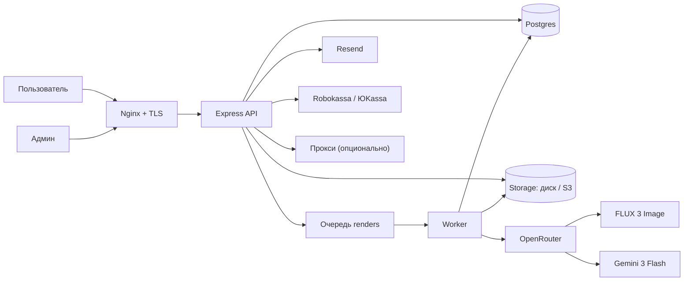
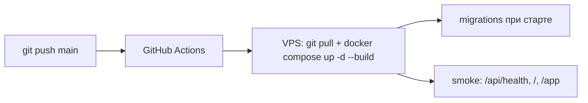

# Архитектура

Карта системы: [architecture.png](architecture.png) · [architecture.svg](architecture.svg).

## Верхнеуровневая схема

## Компоненты

| Компонент | Ответственность | Код |
|---|---|---|
| Nginx | TLS, HSTS, проксирование на `127.0.0.1:3000`, apex → www | конфиг на VPS |
| Express API | auth, комнаты, рендеры, смета, админка, шаринг, платежи, статика | `src/server.js` |
| Worker | забирает `renders` из Postgres, очищает/генерирует/анализирует | `src/jobs.js` |
| Cleanup | пустой каркас перед дизайном при `keep_furniture=false` | `src/cleanupconfig.js`, `src/openrouter.js` |
| Postgres | пользователи, комнаты, рендеры, товары, стили, кредиты, платежи, лайки | `src/db.js`, `migrations/` |
| Storage | фото комнат, рендеры, картинки товаров/референсов | `src/storage.js` |
| OpenRouter | image generation и vision | `src/openrouter.js` |
| Resend/SMTP | OTP-коды и письма | `src/auth.js` |
| Robokassa / ЮKassa | платежи, ResultURL/вебхуки, возвраты | `src/payments.js`, `src/robokassa.js` |
| Proxy | обход WAF OpenRouter с VPS | `src/proxy.js` |
| React | лендинг/генератор, кабинет, админка, публичный шаринг | `web/src/` |

## Потоки

### Создание генерации

1. `POST /api/rooms` (multipart) принимает фото, стиль/референс, room type, класс, флаги.
2. Проверяются auth, кредит, rate limit.
3. Создаётся `rooms` + `renders(status=queued)`, списывается кредит (атомарно).
4. Worker забирает render, собирает контекст и вызывает OpenRouter.
5. Результат сохраняется в Storage, смета — в `render_items`, анализ — в `renders.analysis`.
6. UI поллит `GET /api/rooms/:id` до `done`/`error`.

### Правка

`POST /api/rooms/:id/iterate` создаёт дочерний render с `parent_render_id`, коротким edit-промтом и референсом (товар/файл/URL). Смета копируется у родителя, заменяется только target. Для товарной правки vision сравнивает родителя, результат и карточку: при провале QA дочерний render получает `rejected`, родитель остаётся последней успешной версией, кредит возвращается.

### Публичный шаринг

`POST /api/renders/:id/share` создаёт/возвращает `share_token`. Публичная страница `/s/:token` отдаёт только картинку, стиль, комнату, лайки и комментарии. Смета и фото комнаты не публикуются.

## Данные

| Таблица | Назначение |
|---|---|
| `users`, `sessions`, `auth_identities` | аккаунты и вход |
| `rooms` | комната: фото, стиль, room type, tier, флаги, style ref |
| `renders` | версия: prompt, model, cost, image, analysis, share_token, edit refs |
| `render_items` | смета конкретного рендера |
| `products` | каталог: категория, цена, tier, room_types, dimensions, URL, картинка |
| `styles` | стили: prompt_description, обложка |
| `style_references` | hero/board/upload референсы, room_type, approved, score |
| `style_products` | избранные товары стиля/комнаты |
| `credit_txn`, `payments` | кредиты и платежи |
| `render_likes`, `render_comments` | публичный шаринг |
| `product_clicks` | клики из сметы через `/go/:id` |
| `app_settings` | модели, прокси, правила промта |
| `legal_docs`, `legal_acceptances` | оферта/ПДн/акцепты |
| `_migrations` | применённые SQL-миграции |

## Деплой

- VPS: Docker Compose, Postgres 16, app-контейнер, том `appdata`, `pgdata`.
- Nginx и Let's Encrypt — на хосте.
- `.env` на VPS не перезаписывается деплоем.
- S3 включается переменными; иначе диск.

## Безопасность

- httpOnly cookie `rv_sid`, OTP, сессии 365 дней.
- Owner-check на комнаты, файлы, рендеры.
- Админка по `X-Admin-Key` (`ADMIN_KEY`).
- SSRF-защита при загрузке картинок по URL.
- Санитайз изображений (EXIF/GPS) через sharp.
- Секреты только в env, не в git.
- Прокси-пароль маскируется в API.

## Текущие ограничения

- Один основной провайдер (OpenRouter).
- Нет автоматического выбора из 2–4 дизайн-вариантов и inpainting.
- Каталог демонстрационный, 0 URL.
- Нет автоматических бэкапов/метрик.
- Старый `/app` не в новом стиле.

## Связанные документы

- [GENERATION.md](GENERATION.md)
- [CATALOG.md](CATALOG.md)
- [ADMIN.md](ADMIN.md)
- [API.md](API.md)
- [OPERATIONS.md](OPERATIONS.md)
- [ROADMAP.md](ROADMAP.md)
