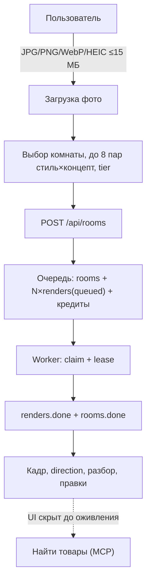
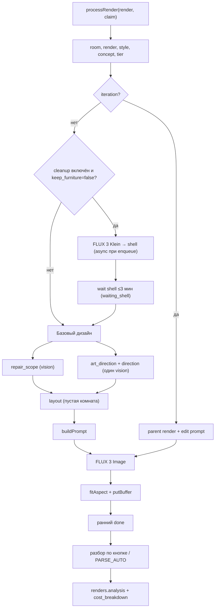

# Полный сценарий генерации: данные, источники и зависимости

Как фото превращается в дизайн: запросы, данные, себестоимость. Код: `src/server.js`, `src/jobs.js`, `src/openrouter.js`, `src/artdirector.js`, `src/layoutagent.js`.

## 1. Пользовательский сценарий

## 2. Пайплайн рендера

## 3. Что откуда берётся

| Данные | Источник | Куда попадает |
|---|---|---|
| Фото комнаты | `rooms.photo_path` | art director, design, QA |
| Пустой каркас | `rooms.precleaned_shell_path` | source для design |
| Родительский рендер | `renders.parent_render_id` | source и смета для правок |
| Тип комнаты | `rooms.room_type`; `app_settings.roomtypes.config.v1` | prompt, слоты, электрика |
| Стиль | `styles` (`name`, `key`, `prompt_description`) | style brief |
| Концепция | `designdata.js`, `renders.concept` | direction |
| Фото-референсы | `style_references` (approved) | 1 art ref в режиме `reference` |
| Режим стиля | `style.config.v1` | text/reference/swatches |
| Класс материалов | `rooms.price_tier` | prompt, материалы |
| Размеры | `rooms.room_width_m/...` + vision | prompt, scale plan |
| Direction | `artdirector.js` + `room_analysis` | `ART DIRECTION` / `direction` |
| Промт-правила | `app_settings.prompt.rules.v1` | light/cleanup/window/… |
| Модель | `app_settings.model.render` > env | `generateRender` |
| Модель правок | `app_settings.model.edit` > env; пусто = render | iterate |
| Vision | `app_settings.model.vision` > env | review/QA/art direction |
| Очистка | `cleanup.config.v1` | `generateCleanupRender` |
| Каталог | `products`, `style_products` | старые рендеры/правки |
| Товары по рендеру | catalog-service (MCP) | `render.analysis.products` |
| Прокси | `app_settings`/env | все OpenRouter-запросы |
| Кредиты | `credit_txn` | списание/возврат |
| Себестоимость | `usage.cost` | `renders.cost_usd` / `meta.cost_breakdown` |

## 4. Себестоимость

| Ключ | Запрос | Когда |
|---|---|---|
| `repair_scope` | vision: объём ремонта | базовый, если не MOCK |
| `art_direction` | vision: факты по фото + direction (если есть концепция) | базовый |
| `layout` | vision: расстановка | пустая комната |
| `cleanup` (async) | FLUX 3 Klein | первый enqueue комнаты, `keep_furniture=false`; стоимость в `rooms.cleanup_cost_usd` |
| `design` | FLUX 3 Image | всегда |
| `design_retry` | повтор дизайна | architecture QA |
| `architecture_qa` | vision-QA | `ARCHITECTURE_QA_ENABLED=1` |
| `product_qa` | vision-QA товара | правка с product ref |
| `render_analysis_auto` | vision-разбор | `PARSE_AUTO=1`, после раннего done |
| `render_analysis` | fallback-разбор | `ARCHITECT_ON_DEMAND=false` |
| `failed` | стоимость упавшего запроса | ошибка |

Смотреть: кабинет → «Себестоимость», `GET /api/rooms/:id` → `render.cost_usd/cost_breakdown`, админка «Логи», логи `render_done`/`render_error`.

## 5. Режимы

| Флаг | Влияет на |
|---|---|
| `keep_furniture=true` | один проход, мебель сохраняется |
| `keep_furniture=false` | очистка (если включена) → дизайн |
| `style.config.mode=text` | только текст, без фото-референса (default) |
| `style.config.mode=reference` | 1 approved art ref |
| `style.config.mode=swatches` | material board |
| `ART_DIRECTION_ENABLED=0` | отключает арт-директора |
| `ARCHITECTURE_QA_ENABLED=0` | без QA архитектуры (default) |
| `PARSE_AUTO=1` | авто-разбор после раннего done (default off) |
| `WORKER_CONCURRENCY` | параллелизм рендеров (1–8, default 6) |

## 6. Ошибки и кредиты

- Ошибка запроса → `renders.error`, `rooms.error`; кредит возвращается.
- Товарный QA rejected → `rejected`, кредит возвращается, родитель активен.
- Зависание: lease/requeue; processing > 60 мин → error + refund.
- Себестоимость в USD не возвращается: провайдер уже списал.
- 402 → пополнение; 401 → вход; 409 → рендер идёт.

## 7. Связанные документы

- [GENERATION.md](GENERATION.md)
- [GENERATION-QUEUE.md](GENERATION-QUEUE.md)
- [STATUS.md](STATUS.md)
- [PROCUREMENT.md](PROCUREMENT.md)
