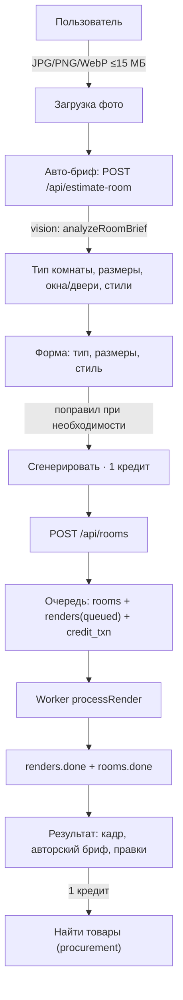
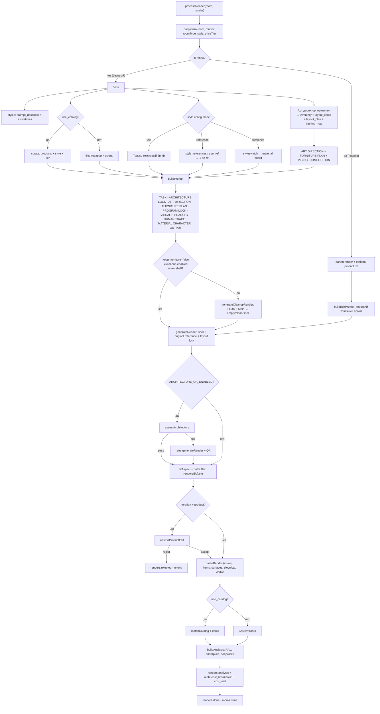

# Полный сценарий генерации: данные, источники и зависимости

Это карта того, как фото превращается в готовый дизайн: какие запросы уходят, какие данные в них участвуют, откуда они берутся и как считается себестоимость. Код: `src/server.js`, `src/jobs.js`, `src/openrouter.js`, `src/artdirector.js`.

## 1. Пользовательский сценарий



## 2. Полный пайплайн рендера



## 2.1. Layout-first: план на всю комнату, кадр — только видимое

Арт-директор **не охраняет старую планировку** и не обязан сохранять сантехнику. Он проектирует новую планировку под размеры комнаты:

1. **Смотрит на оригинал** (`room.photo_path`), получает точные размеры и SCALE PLAN. Инвентаризация включает **всю** крупную мебель и зоны: кровать, стол, шкаф, ТВ, стеллажи, мурал, окно/дверь/радиатор.
2. **Считает, что физически помещается:** `layout_items` с `width_cm`/`depth_cm`/`height_cm`/`clearance_cm`, `layout_plan` с точными позициями и проходами.
3. **Фиксирует функцию:** `room_function` (teen/child/adult), `functional_zones` (sleep/study/storage/media), `keep_features` (мурал, встроенный шкаф), `bed_type` (single остаётся single).
4. **Детерминированно проверяет арифметику:** `layoutCorrection` считает боковые проходы кровати, шкаф на боковой/задней стене и предмет напротив; при противоречии добавляет `LAYOUT CORRECTION` и уменьшает кровать/убирает шкаф. Текстовому плану арт-директора не доверяем.
5. **Отделяет план от кадра:** `framing_note` описывает, что видит камера, но **не может скрывать двери/окна/стены** — только мебель/декор.
6. **Дизайн-модель получает:** shell (если использовался) + style ref, `ART DIRECTION`, `FURNITURE PLAN`, `PROGRAM LOCK`, `VISUAL HIERARCHY` / `CONTROLLED DENSITY`, `HUMAN TRACE` (книга + чашка), `MATERIAL CHARACTER` и короткий `OUTPUT`. Оригинал в генерацию не идёт.
7. **QA размеров** (`assessDimensions`) проверяет габариты, проходы, функцию, тип кровати и сохранность дверей/окон; при провале — один retry с `DIMENSION CORRECTION`.

Правильная последовательность:

```
оригинал → art director (inventory + layout_items + layout_plan + framing_note)
         → cleanup (optional)
         → design (план + кадр + живые детали)
         → dimension QA (retry при провале)
```

Пустая комната арт-директору не нужна. Она нужна только дизайн-модели как чистый холст, если включена очистка; план при этом всё равно задаёт арт-директор.

## 3. Что откуда берётся

| Данные | Источник | Куда попадает |
|---|---|---|
| Фото комнаты | `rooms.photo_path` (uploads) | art director (оригинал), design (reference для сантехники/планировки), architecture QA |
| Пустой каркас | `rooms.precleaned_shell_path` или `renders.shell_path` | источник для design, если очистка была; fixtures обязаны сохраниться |
| Родительский рендер | `renders.parent_render_id` | источник и смета для правок |
| Тип комнаты | `rooms.room_type`; конфиг `app_settings.roomtypes.config.v1` или `src/roomtypes.js` | prompt, слоты, keep/change/forbid, электрика, стилизация |
| Стиль | `rooms.style` → `styles` (`name`, `key`, `prompt_description`, `swatches`, `active`) | style brief, валидация, обложка |
| Фото-референсы стиля | `style_references` (approved, по комнате) + пользовательский `rooms.style_ref_path` | 1 art ref в `reference`-режиме |
| Товары стиля | `style_products` → `products` | curate, материалы/пол/стены в промте |
| Режим стиля | `app_settings` (`style.config.v1`, `src/styleconfig.js`) | text / reference / swatches |
| Класс материалов | `rooms.price_tier` → `src/pricing.js` | curate, MATERIAL CLASS, смета |
| Размеры комнаты/кровати | `rooms.room_width_m/length_m/height_m/bed_length_m/dimension_orientation` | ROOM DIMENSIONS, `src/scaleplan.js`, BED SIZE |
| Ориентация размеров | `rooms.dimension_orientation` | уточнение ширины/длины в промте |
| Правила промта | `app_settings.prompt.rules.v1` + дефолты `src/promptconfig.js` | dimensions, scalePlan (fallback), bed (fallback), radiators, cleanup, window, furniture, catalog, extra. `pinterest`/`photo`/`avoid` — legacy, больше не инжектятся |
| Арт-директор | `buildArtDirection(photo, roomType, styleDescription, dimensions, scalePlan)` → vision | `room_function`, `bed_type`, `functional_zones`, `keep_features`, `layout_items`, `layout_plan`, `framing_note`, `ART DIRECTION`; `renders.meta.art_direction` |
| План мебели | `art_direction.layout_items` (`type`, `description`, `width_cm`, `depth_cm`, `height_cm`, `position`, `clearance_cm`) | блок `FURNITURE PLAN — HARD DIMENSIONS` в промте |
| Программа комнаты | `room_function`, `functional_zones`, `keep_features`, `bed_type` | блок `PROGRAM LOCK`: sleep + study/desk + storage + media; single не апгрейдится до double; мурал/фичи сохраняются |
| Валидатор планировки | `layoutCorrection` в `src/scaleplan.js` | проверяет боковые проходы <60 см, шкаф и предмет напротив; при противоречии добавляет `LAYOUT CORRECTION` и правит ширину кровати |
| Художественный слой | `ART DIRECTION` + `VISUAL HIERARCHY` + `CONTROLLED DENSITY` + `HUMAN TRACE` + `MATERIAL CHARACTER` | один главный акцент, 1–2 поддерживающих, без заполнения всех поверхностей, 2 живые детали |
| Офисная концепция | `roomtypes.concept` для `Кабинет` + `Скандинавский` | deep ink-blue / oak / cognac leather / крупный арт / workspace monitor-keyboard; заменяет художественные блоки, план остаётся источником размеров |
| OUTPUT | код `buildPrompt` | сохраняет камеру источника, короткий список запретов; без 24–35mm/golden hour/8k/medium format |
| Кадр | `art_direction.framing_note` | блок `VISIBLE COMPOSITION — DO NOT CRAM`: план на всю комнату, но в кадр не впихивать всё |
| Оригинал | `rooms.photo_path` | только арт-директор и QA; в design-модель не передаётся, чтобы не смешивать старую мебель/отделку с новой планировкой |
| Модель дизайна | `app_settings.model.render` > `RENDER_MODEL` > код-дефолт | `generateRender`, `renders.model` |
| Разрешение/aspect | `app_settings.model.resolution/aspect_ratio` > env | image-запрос, `snapAspect` по фото |
| Vision-модель | `app_settings.model.vision` > `VISION_MODEL` | арт-директор, бриф, анализ рендера, QA |
| Очистка | `app_settings.cleanup.config.v1` (`src/cleanupconfig.js`) | `generateCleanupRender`, shell |
| Каталог | `products` + `style_products` + `matchCatalog` | в дизайне отключён: товары и смета не используются |
| Прокси | `app_settings` / env (`src/proxy.js`) | все OpenRouter-запросы |
| Кредиты | `users.balance` + `credit_txn` | списание 1 кредита, возврат при ошибке/QA |
| Себестоимость | `usage.cost` каждого запроса | `renders.cost_usd` и `renders.meta.cost_breakdown` |

## 4. Себестоимость полной генерации

Один базовый дизайн может включать до 5+ платных запросов. Все они суммируются в `renders.cost_usd`, разбивка — в `renders.meta.cost_breakdown`:

| Ключ | Запрос | Когда |
|---|---|---|
| `art_direction` | vision-арт-директор | базовый рендер, если `ART_DIRECTION_ENABLED≠0` |
| `cleanup` | FLUX 3 Image Klein | `keep_furniture=false` + очистка включена + нет shell |
| `design` | FLUX 3 Image 1K | всегда |
| `design_retry` | повторный дизайн | architecture QA отклонил первый кадр |
| `architecture_qa` | vision-QA | `ARCHITECTURE_QA_ENABLED=1` (по умолчанию 0) |
| `product_qa` | vision-QA товара | правка с привязкой товара |
| `render_analysis` | vision-анализ рендера | всегда, для RAL/электрики/подсказок |
| `dimension_qa` | vision-QA размеров | базовый рендер с размерами и планом |
| `failed` | стоимость упавшего запроса | ошибка на любом этапе |

Где смотреть:
- кабинет → «Мои дизайны» → комната → «Себестоимость генерации» (итог + разбивка);
- API: `GET /api/rooms/:id` → `render.cost_usd`, `render.cost_breakdown`;
- API: `GET /api/my/generations` → `cost_usd`, `cost_breakdown`;
- админка «Логи» → `renders.cost_usd`, `renders.meta.cost_breakdown`;
- админка «Логи» → блок «Арт-директор»: `ART DIRECTION`, `layout_plan`, `framing_note`, таблица объектов (`type`, `description`, размеры, позиция, проход) и «Промт дизайнера»;
- кабинет → «Авторский бриф»: план, кадр и список объектов с описанием и размерами;
- JSON-логи `render_done` / `render_error` → `cost_breakdown`.

## 5. Режимы и зависимости

| Флаг | Влияет на |
|---|---|
| `keep_furniture=true` | только если пользователь явно включил; существующая мебель сохраняется, очистка не запускается |
| `keep_furniture=false` | **дефолт**; очистка (если включена) → дизайн с нуля |
| `use_catalog=true` | не используется: каталог принудительно выключен в дизайне |
| `use_catalog=false` | всегда; свободный дизайн, без товаров и сметы |
| `style.config.mode=text` | только текстовый style brief, пользовательский фото-референс игнорируется |
| `style.config.mode=reference` | 1 art ref: пользовательский > approved hero > обложка |
| `style.config.mode=swatches` | material board из `styleswatch`, без архитектуры |
| `ART_DIRECTION_ENABLED=0` | отключает vision-арт-директора |
| `ARCHITECTURE_QA_ENABLED=1` | включает QA архитектуры и retry (дороже) |

## 6. Ошибки, кредиты и стоимость

- Ошибка любого запроса → `renders.error`, `error_stage`, `rooms.error`; кредит возвращается.
- Товарный QA rejected → `renders.rejected`, кредит возвращается, родительский кадр остаётся.
- Себестоимость в USD не возвращается: провайдер уже списал деньги; в `cost_usd` попадает сумма известных запросов, включая `failed`.
- 402 → UI открывает пополнение; 401 → вход; 409 → комната ещё генерируется.
