# Генерация

Как фото превращается в дизайн, смету, RAL и правки.

## Режимы

| Режим | Что делает | Флаги комнаты |
|---|---|---|
| Обычный редизайн | меняет отделку, свет, текстиль; крупная мебель сохраняется/двигается | `keep_furniture=true` |
| Свободный дизайн | очищает комнату до пустого каркаса, затем обставляет заново | `keep_furniture=false` + очистка включена |
| С каталогом | подбирает товары, строит смету, ссылки | `use_catalog=true` |
| Без каталога | свободный дизайн без товаров и сметы | `use_catalog=false` |

Важно: при выключенной мебели работает **два прохода**: очистка (пустой каркас) → дизайн. Очистка настраивается в админке «Очистка» и по умолчанию включена. Если мебель сохраняем — очистка не применяется, один проход.

## Путь первого рендера

```mermaid
flowchart LR
  A["Фото + комната + стиль/ref + класс"] --> B["POST /api/rooms"]
  B --> C["credit + room + render queued"]
  C --> D["Worker"]
  D --> E["room types + style + tier"]
  E --> F["style refs: user > approved hero > cover"]
  F --> G["curate: room slots × tier × style"]
  G --> H["prompt: roles, keep/change, light, styling, catalog, dimensions"]
  H --> C1["cleanup: FLUX 3 Klein → empty shell"] 
  C1 --> I["design: FLUX 3 Image"]
  I --> J["fitAspect + storage"]
  J --> K["Gemini vision"]
  K --> L["items + surfaces + RAL + electrical + suggestions"]
  L --> M["render_items + analysis + done"]
```



### 1. Ввод

`POST /api/rooms` (multipart):

- `photo` — фото комнаты;
- `room_type` — один из активных типов комнат (по умолчанию 12);
- `style` — название стиля или пусто, если есть референс;
- `style_ref` / `style_ref_url` — пользовательский референс;
- `price_tier` — `start|comfort|premium|atelier`;
- `keep_furniture` — `1/0`;
- `use_catalog` — `1/0`;
- `palette`, `accent`;
- `room_width_m`, `room_length_m`, `room_height_m` — необязательные реальные размеры комнаты; заполняются только все три вместе;
- `bed_length_m` — только для спальни/детской; если не передан, подставляется 2.0 м. Для остальных комнат игнорируется;
- `dimension_orientation` — что считается шириной/длиной, например «ширина — стена с окном».

Если нет стиля и нет референса — API возвращает 400. Если стиль не выбран, но референс есть — стиль становится `Референс пользователя`. Размеры валидируются: комната 1–30 м, высота 2–10 м, кровать 1–4 м.

Перед созданием комнаты пользователь может нажать «Определить по фото»: `POST /api/estimate-room` (multipart `photo`, `room_type`) вызывает vision-модель, оценивает ширину/длину/высоту по типовым ориентирам (дверь, кровать, шкафы, перспектива) и возвращает `width_m`, `length_m`, `height_m`, `bed_present`, `confidence`, `reasoning`. Значения только заполняют поля формы — пользователь обязан проверить и поправить их перед генерацией.

### 2. Очередь и кредит

- Создаётся `rooms` + `renders(status=queued)`.
- Один кредит списывается атомарно; при ошибке/таймауте возвращается.
- Worker держит до 2 параллельных рендеров.

### 3. Стиль и референсы

Приоритет:

1. пользовательский `style_ref_path` — переопределяет админские/обложку;
2. approved `style_references` для стиля + комнаты (hero, затем board/upload);
3. статическая обложка стиля.

В базовый дизайн уходит исходник + максимум **один art reference**, без изображений товаров. Art ref передаёт только свет, атмосферу, палитру, материалы и стайлинг; мебель, планировку и композицию из него копировать запрещено. Product ref появляется позже — в отдельной точечной правке.

### 4. Curate

`src/curate.js`:

- тип комнаты задаёт слоты (`src/roomtypes.js`);
- класс материала (`price_tier`) задаёт уровень;
- стиль — точный тег 1.0, синоним 0.6;
- `style_products` (избранные) имеют приоритет;
- товары с реальным URL используются в style kit; для обычной генерации берутся активные товары;
- каждому товару присваивается `slot` (bed, floor, wall, light, …).

### 5. Prompt

Собирается в `src/openrouter.js`:

- карта изображений: 1 — исходник, 2 — необязательный art ref; product refs отсутствуют;
- `ROOM DIMENSIONS AND SCALE` — реальные ширина/длина/высота, если пользователь их указал;
- `SCALE PLAN` — вычисленный `src/scaleplan.js` план: размер кровати по ширине комнаты, проходы, кухня по площади, низкие потолки, узкие и длинные комнаты;
- `BED SIZE` — полная длина кровати с каркасом, если указана;
- `RADIATOR COVERS` — вентилируемые экраны для видимых радиаторов; не выдумывать их, если радиаторов нет;
- `KEEP EXACTLY` — архитектура, камера, окна/двери, мебель (если включено);
- `FURNITURE MODE` — сохранить/убрать;
- `CHANGE / DEEP TRANSFORMATION`;
- `COMPOSITION`;
- `LIGHTING DESIGN` — главный wow-инструмент;
- `CLEANUP / REALISM` — ТВ, провода, радиатор, старые зеркала/люстры;
- `WINDOW STYLING` — шторы/жалюзи;
- `LIFE & STYLING` + `PINTEREST-LEVEL STYLING` — арт, полки, техника, плюш, декор;
- `CATALOG / MATERIALS` — текстовые материалы, цвета, фактуры и габариты; hero-мебель в этот список не входит;
- `STYLE`, `MATERIAL CLASS`;
- `OUTPUT` — фото-язык (24–35 мм, golden hour, film grain, не CGI);
- `AVOID` — негативный список.

Правила `lighting`, `dimensions`, `scalePlan`, `bed`, `radiators`, `cleanup`, `window`, `pinterest`, `photo`, `furnitureOn/Off`, `catalogOn/Off`, `extra`, `avoid` редактируются в админке («Промт») и хранятся в `app_settings.prompt.rules.v1`. Дефолты — в `src/promptconfig.js`.

### 6. Очистка и image generation

- Если `keep_furniture=false` и очистка включена: первый вызов — FLUX 3 Image Klein 1K auto с промтом очистки. Он убирает мебель/декор/старые предметы, оставляя архитектуру, окно, размеры и перспективу. Результат — `shell_path`.
- Второй вызов — дизайн: FLUX 3 Image (модель из app_settings), 1K, aspect auto, source = пустой каркас.
- Если очистка выключена/упала — дизайн идёт с исходного фото, ошибка в `renders.meta.cleanup.error`.
- Очистка стоит ещё один вызов, но кредит пока списывается один.
- Основной провайдер: OpenRouter Image API `/images`.
- Для FLUX 3 Image/Klein и Seedream отправляются `resolution` и `aspect_ratio`; FLUX 2 Pro resolution не принимает.
- Для FLUX/Gemini `resolution` не отправляется.
- FLUX.2 Pro: не принимает `resolution`; возможна блокировка content moderation на спальнях/кроватях.
- Исходник и референсы идут как `input_references`.
- Выход прогоняется через `fitAspect` к пропорции исходника.
- Стоимость (`usage.cost`) пишется в `renders.cost_usd`.

### 7. Vision analysis

`parseRender` (Gemini) возвращает:

```json
{
  "items": [{"category": "floor", "description": "...", "keywords": ["..."]}],
  "surfaces": [{"surface": "walls", "hex": "#E8DCCB", "description": "..."}],
  "visible": ["bed", "pendant light", "..."],
  "electrical": [{"title": "...", "text": "..."}]
}
```

- `surfaces` → `nearestRal` только для стен/потолка/фасадов; дерево/плитка не переводятся в RAL.
- `electrical` — vision + шаблон комнаты.
- `suggestions` — 4 быстрые правки по слотам и альтернативным товарам.
- Анализ хранится в `renders.analysis`.

### 8. Смета

- Первый рендер: curated-товары — источник сметы; vision только добавляет недостающие группы.
- `curated` — подобран к дизайну, точное присутствие не подтверждено; `matched` — похожая позиция по vision; `verified` — конкретный товар прошёл QA после товарной правки.
- Правка: копируется смета родителя, заменяется только target (товар из подсказки фиксируется).
- Стены `paint`/`wallpaper` — одна группа.
- Для товаров с URL ссылка идёт через `/go/:productId?r=renderId`; для демо — поиск.
- `/go` логирует клик в `product_clicks`.

## Правки

`POST /api/rooms/:id/iterate`:

- `text` — инструкция;
- `target` — `light`, `floor`, `wall`, `tile`, `faucet`, …;
- `product_id` — товар из быстрой подсказки;
- `ref` — файл;
- `ref_url` — ссылка;
- `parent_id` — версия, от которой правим.

Edit-промт короткий:

```text
Image 1 — current render.
Image 2 — reference for the new pendant.
Change only the pendant. Keep everything else exactly as in Image 1.
```

Это лучше, чем полный стилевой промт: модель не перерисовывает комнату. У product ref используются только внешний вид и габариты товара; фон, студийный свет, ракурс и стейджинг карточки игнорируются. При `keep_furniture=true` нельзя заменять крупную мебель.

Для товарной правки `assessProductEdit` получает родителя, результат и карточку товара. Он проверяет `architecture_preserved`, `product_match`, `no_artifacts`, `quality_not_worse`; принимаются только четыре строгих `true`. При отказе или ошибке QA дочерний render получает `rejected`, родитель остаётся активным, причина записывается в `rooms.notice`, кредит возвращается с reason `product_qa_rejected`. Смета отклонённой версии не публикуется. В mock-режиме QA имеет статус `skipped`, поэтому товар остаётся `curated`, а не `verified`.

## Ошибки и кредиты

- Ошибка generation/vision → `render.error`, `room.error`, кредит возвращается.
- Отказ товарного QA → `render.rejected`, `rooms.notice`, прежняя версия сохраняется, кредит возвращается.
- Таймаут 24 часа → ошибка + возврат кредита.
- 402 → UI открывает пополнение.
- 401 → требуется вход.
- 409 → комната ещё генерируется.

## Логи

- JSON-логи в stdout: `render_start`, `render_endpoint`, `render_image_ok`, `render_analysis`, `render_matched`, `render_done`, `render_error`.
- Товарный QA: `product_qa_done`, `product_qa_rejected`, `product_qa_error`; результат и стоимость пишутся в `renders.meta.product_qa` и `renders.cost_usd`.
- Полный промт хранится в `renders.prompt`, метаданные (pipeline, refs, model, tier, flags) — в `renders.meta`.
- В админке «Логи» видно промт, модель, стоимость, референсы и отклонённые версии.

## Текущие ограничения

- Очистка + дизайн работают только при выключенной мебели; при включённой — один проход.
- Нет автоматической генерации и выбора 2–4 дизайн-вариантов; нужны отдельные UI выбора и биллинг.
- Нет inpainting для люстр/розеток; товарная привязка использует обычную edit-генерацию.
- Очистка добавляет второй вызов, но биллинг пока 1 кредит.
- Один основной провайдер.
- Каталог демонстрационный, 0 URL.
- Vision может ошибаться в мелких предметах; curated защищает смету от ложного обещания точного совпадения.

## Связанные документы

- [CATALOG.md](CATALOG.md)
- [PROMPT-RULES.md](PROMPT-RULES.md) — если добавлен отдельный файл; иначе раздел в ADMIN.md
- [OPS.md](OPERATIONS.md)
- [HISTORY.md](HISTORY.md)
