# Генерация

Как фото превращается в дизайн, правки и разбор. Актуальное состояние — [STATUS.md](STATUS.md).

## Режимы

| Режим | Что делает | Флаги комнаты |
|---|---|---|
| Обычный редизайн | меняет отделку, свет, текстиль; мебель сохраняется/двигается | `keep_furniture=true` |
| Свободный дизайн | очищает комнату до пустого каркаса, затем обставляет | `keep_furniture=false` + очистка включена |
| Мульти-стиль | до 8 пар «стиль × концепция», каждая — отдельный рендер | `items: [{style, concept}]` |

Очистка **выключена по умолчанию** (`cleanupconfig.js`). При `keep_furniture=false` и включённой очистке — два прохода: shell → дизайн.

## Путь базового рендера

```mermaid
flowchart LR
  A["Фото + items + тип + tier"] --> B["POST /api/rooms"]
  B --> C["N × renders(queued) + кредиты"]
  C --> W["Worker: claim + lease"]
  W --> V["repair_scope ∥ art_direction + direction"]
  V --> L["layout (пустая комната)"]
  L --> P["buildPrompt (design-first)"]
  P --> C1["cleanup (если включён)"]
  C1 --> I["design: FLUX 3 Image"]
  I --> S["fitAspect + storage"]
  S --> R["architect review (vision)"]
  R --> ANA["analysis: surfaces/RAL/electrical/suggestions"]
  ANA --> DONE["render done"]
```

### 1. Ввод

`POST /api/rooms` (multipart): фото, `items` (1–8 `{style, concept}`), тип комнаты, tier, флаги, размеры, разрешение, модель. Валидация: нет фото → 400, нет стиля/items → 400, размеры 1–30 м, высота 2–10 м, кровать 1–4 м.

### 2. Очередь и аренда

- В одной транзакции создаются `rooms` и N `renders(status=queued)`; кредит списывается за каждый вариант.
- `claimNextRender` — `FOR UPDATE SKIP LOCKED` + lease 5 минут + `claimed_by`.
- Heartbeat каждые 30 с; requeue/reaper — только истёкшие lease; processing старше 60 минут → error + refund.
- `WORKER_CONCURRENCY` (1–8) — сколько рендеров в работе в процессе; image-вызовы сериализуются глобальным слотом.

### 3. Стиль и референсы

Режим стиля (`style.config.v1`): `text` (по умолчанию), `reference`, `swatches`.

- `reference`: approved `style_references` для комнаты; в базовый кадр — **один** art ref.
- `swatches`: material board из стиля.
- Пользовательский style-ref и hero-референсы по умолчанию не используются (режим `text`).
- Product refs в базовый кадр не попадают: только в точечную правку.

### 4. Vision-этапы

- `repair_scope` — объём ремонта (пол/потолок/стены/двери), параллельно с арт-директором.
- `art_direction` — один vision-вызов: размеры, объектив, мебель, палитра и (при концепции) `direction` в том же JSON.
- `layout` — только для пустой комнаты.

### 5. Direction и кэш

- Один вызов агента (`maxSteps: 1`); повтор только при нераспарсенном JSON.
- Кэш `generation_cache`: 3 варианта на `стиль|концепт|комната|точные размеры|версия промта`, TTL 30 дней.
- Выбор варианта — детерминированный хэш по `sessionId`; «не повторяй прошлые ходы» применяется при выборе.
- Пустой `prompt_en` → fallback на art direction и негативный маркер на сутки.
- Настройки: `DIRECTION_CACHE_ENABLED`, `DIRECTION_CACHE_VARIANTS` (1–3), `DIRECTION_CACHE_TTL_DAYS`.

### 6. Промт

`src/openrouter.js`:

- карта изображений: исходник + необязательный art ref; product refs нет;
- `ARCHITECTURE LOCK`, `ART DIRECTION`, `ROOM DIMENSIONS AND SCALE`, `SCALE PLAN`, `BED SIZE`, `RADIATOR COVERS`;
- `KEEP EXACTLY`, `FURNITURE MODE`, `CHANGE / DEEP TRANSFORMATION`, `COMPOSITION`, `LIGHTING DESIGN`;
- `CLEANUP / REALISM`, `WINDOW STYLING`, `LIFE & STYLING`, `PINTEREST-LEVEL STYLING`;
- `STYLE`, `MATERIAL CLASS`, `OUTPUT`, `AVOID`.

Правила редактируются в админке «Промт» (`app_settings.prompt.rules.v1`), дефолты — `src/promptconfig.js`. Известный баг: `furnitureOff`, `catalogOn`, `styling` не доходят до генерации (см. [docs/redesign](redesign/2026-11-11-redesign-codebase/redesign.md)).

### 7. Очистка и image generation

- При `keep_furniture=false` + включённой очистке: FLUX 3 Klein → `shell_path`, затем дизайн по shell.
- Основной вызов — FLUX 3 Image (модель/разрешение из админки), 1K/auto по умолчанию.
- `resolution` не отправляется для моделей, которые его не поддерживают (FLUX 2 Pro).
- Выход прогоняется через `fitAspect` к пропорции исходника; стоимость (`usage.cost`) — в `renders.cost_usd`.
- Без `OPENROUTER_API_KEY` — mock-режим: демо-картинка, расходов нет.

### 8. Анализ

`reviewDesign` (vision) возвращает items, surfaces, hints, electrical. Fallback — `parseRender`. RAL считается только для окрашиваемых поверхностей. Анализ — в `renders.analysis`.

### 9. Смета

**Важно:** для новых базовых рендеров `render_items` пуст (design-first). Смета заполняется у старых рендеров и при правках (копируется у родителя). Подбор товаров — отдельный MCP-путь, см. [PROCUREMENT.md](PROCUREMENT.md).

## Правки

`POST /api/rooms/:id/iterate`:

- `text`, `target`, `product_id`, `refs`/`ref_meta`, `ref`/`ref_url`, `parent_id`, `move`.
- Первые 3 правки бесплатны, 4-я и далее — 1 кредит.
- Edit-промт короткий: «Image 1 — current render; Image 2 — reference; change only X».
- Товарная правка: vision QA проверяет архитектуру, соответствие товару, артефакты, качество; все четыре `true` — иначе `rejected` + refund.

## Ошибки и кредиты

- Ошибка generation/vision → `render.error`, `room.error`, кредит возвращается.
- Таймаут/зависание → error + refund.
- 402 → пополнение; 401 → вход; 409 → комната ещё генерируется.

## Логи и метрики

- `render_start`, `repair_scope_ok`, `art_direction_ok`, `design_direction_ok`, `room_analysis_cache_hit`, `render_image_ok`, `render_done`, `render_error`, `render_lease_lost`.
- `renders.prompt`, `renders.meta`, `renders.cost_breakdown`.
- Замеры ёмкости: [ops/QUEUE-CAPACITY.md](ops/QUEUE-CAPACITY.md).

## Ограничения

- Смета новых рендеров пуста; старый procurement не подключён.
- Нет inpainting люстр/розеток.
- Один провайдер — OpenRouter.
- Style-ref/hero-референсы выключены по умолчанию.
- Часть правил админки не применяется (см. выше).

## Связанные документы

- [GENERATION-FLOW.md](GENERATION-FLOW.md)
- [GENERATION-QUEUE.md](GENERATION-QUEUE.md)
- [PROMPT-RULES.md](PROMPT-RULES.md)
- [API.md](API.md)
