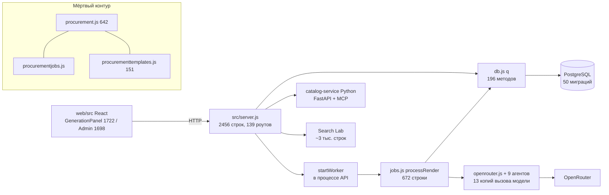

# Redesign: codebase

- **Author**: Oblacko
- **Created**: 2026-11-11
- **Language**: JavaScript (ESM, Node 20), TypeScript/React 19, Python (catalog-service)
- **Scope**: codebase — `app/`
- **Plan**: [plan.md](./plan.md)

## Summary

Кодовая база выросла быстрее, чем её границы: продуктовый пивот последних двух недель (мульти-стиль, MCP-подбор, breakdown/roadmap/move, статьи) добавлялся поверх архитектуры 2026-10-30, не удаляя старую. Итог — мёртвый legacy-контур procurement (~1 200 строк, 6 таблиц), три параллельных UI поиска, дублирование AI-вызова в 13 местах (~600 строк), 8 копий settings-стора и монолиты `server.js` (2 456 строк / 139 роутов) и `processRender` (672 строки). При этом реальный пользовательский и денежный путь — HTTP-роуты, Postgres-транзакции, очередь, auth, платежи — не покрыт тестами вообще, а CI тесты не запускает. Реимплементация: сначала safety net (characterization-тесты + CI-гейт), затем удаление мёртвого, затем одна глубокая точка AI-вызова, фабрики настроек, реестр категорий, роутеры/DTO и инварианты очереди. Документация приводится в соответствие с кодом, а не наоборот.

## Current State

Ключевые файлы и поток:



Точки проблем (подтверждено тремя read-only аудитами и проверкой кода):

- **Очередь**: `claimNextRender` без `FOR UPDATE SKIP LOCKED` (db.js:183), нет индекса `(status, created_at)`, `requeueProcessing()` на старте крадёт in-flight задачи у второй реплики (jobs.js:785), image-слот и rate limiter — per-process состояние (openrouter.js:30-42, ratelimit.js:1-2).
- **Генерация**: `processRender` — 672 строки, 9 стадий, 2 режима, ledger и refund в одном `try/catch` (jobs.js:80-752). Независимые vision-вызовы идут последовательно (jobs.js:252-415).
- **AI-слой**: 6 копий «agent → fallback → retry» (architect, breakdown, roadmap, designeragent, artdirector ×2, layoutagent) и 7 ручных `POST /chat/completions` внутри `openrouter.js` (760-1135) при наличии `visionJson`.
- **Данные**: `db.js` — god-модуль, `createRoom` с 19 позиционными аргументами (db.js:66-69, server.js:1567), 5 самодельных whitelist-patch-билдеров.
- **HTTP**: 139 роутов в `server.js`, `requireAdmin` продублирован 79 раз, DTO-сборка вручную (три копии `design_direction`).
- **Frontend**: нет API-клиента и общих типов — 4×`RoomData`, 3×`ProductMatch`, 34 ручных `json().catch`; `GenerationPanel` — 49 `useState`, `Admin` — 97.

## Findings

### Structure

**Критично — удаление слоёв, не перестановка**

- **C1. Мёртвая legacy-подсистема procurement** — `src/procurement.js` (642), `procurementjobs.js` (42), `procurementtemplates.js` (151), `db.js:479-585`, `migrations/023_procurement.sql`, админ-вкладка `Admin.tsx:1628-1666`. `startProcurement` (479), `processProcurementRun` (523), `procurementDto` (576) не вызываются ни из одного маршрута; `startProcurementWorker` не стартует (server.js:2448-2449 запускает только render/search); `/buy/:id` (server.js:2150) не линкуется из UI. ~1 200 строк, 6 таблиц, отдельная ветка списания кредитов и админ-настройка недостижимы в проде.
- **C2. Контрол-флоу AI-вызова скопирован 6 раз** — `architect.js:273-334`, `breakdown.js:9-75`, `roadmap.js:10-76`, `designeragent.js:~140-195`, `artdirector.js:164-241,243-324`, `layoutagent.js:153-195`: `callAgentJson → visionJson → retry на дефолтной модели → normalize → cost`, каждый со своим env-cascade модели и своим `try/catch{return null}`.
- **C3. 7 дублей `visionJson` внутри `openrouter.js`** — `scoreStyleReference` (760-797), `assessProductEdit` (799-843), `estimateRoomDimensions` (846-887), `parseRender` (890-948), `parseProcurementImage` (951-1034), `scoreProductMatch` (1037-1077), `assessArchitecture` (1080-1135). ~300 строк бойлерплейта; `estimateRoomDimensions` в проде не используется.
- **C4. Два диспетчера одного search-job** — `server.js:1220-1241` (`runSearchStep` синхронно запускает стадию и отвечает 202) и `searchjobs.js:31-52` (воркер каждые 2 с забирает `queued` и всегда выполняет vision). Статус и стадия живут в одной колонке `status`.

**Высоко**

- **H1. `processRender` — 672 строки** (jobs.js:80-752): 9 стадий, ветки base/edit/prepared-source, две одинаковые «rejected»-развязки (590-603, 632-644), `stage`/`meta`/`costBreakdown` — мутабельные переменные через всю функцию. Нет ни одного теста на `jobs.js`.
- **H2. `db.js` — 196 методов**, fan-in 27; `createRoom` с 19 позиционными аргументами (66-69); 5 копий whitelist-patch (`updateProduct` 382, `updatePack` 420, `updateStyle` 606, `updateSearchJob` 677, `updateSearchObject` 714, `updateRoadmapItem` 849) с разными правилами JSON.
- **H3. Категорийная таксономия размазана по 7+ местам и разошлась**: `roomtypes.js:4-300`, `pricing.js:40-102`, `curate.js:20`, `procurementtemplates.js:6-116`, `architect.js:12-22`, `searchvision.js:41-75`, inline-enum `openrouter.js:893,957`, `analysis.js`, Python `categories.py:69`. Дрейф: `wall`/`walls`/`wall_covering`, `light`/`lamps`, `cabinet` в двух значениях.
- **H4. 8 почти идентичных settings-сторов + 2 prompt-стора** — `promptconfig`, `renderconfig`, `styleconfig`, `cleanupconfig`, `procurementconfig`, `searchconfig`, `roomtypes:395-452`, `modelconfig`; `searchprompts`/`architectprompts` — один код. ~450 строк бойлерплейта, разная семантика reset.
- **H5. `server.js`: 139 маршрутов**, `requireAdmin` ×79, `requireAuth` ×20; 8 троек GET/PUT/reset с одинаковой формой (916-1129).
- **H6. DTO-сборка в HTTP-слое и продублирована** — `design_direction` трижды (server.js:1687-1701, 1753-1767, 2205-2212), `art_direction` дважды, `imageDataUrl` 4 раза, mime-map 3+6 раз.

**Средне** (детали в отчёте аудита): цикл `payments↔referral` через динамический импорт (referral.js:7, payments.js:188,257); баланс считается `SUM(delta)` в 7 местах, `spendCredit`/`spendCreditForRender` мертвы; 13 последовательных `load*Config()` (server.js:2415-2430) и 3 последовательных vision-вызова на рендер (jobs.js:252-415); создание комнаты — 137 строк в хендлере (server.js:1463-1600); фронт без API-клиента (4×`RoomData`, 3×`ProductMatch`); `GenerationPanel` 1722/49 `useState`, `Admin` 1698/97, `SearchPipeline` 1091; move-логика на клиенте и сервере; `deleteRoom` не владеет файлами (db.js:94-98, server.js:2165-2171); Python-дубли (`gridai.py` 421 повторяет `searchgrid.js`; три реестра MCP-инструментов).

**Key insight:** одна глубокая точка `runVisionTask({system,user,images,modelPool,normalize,isEmpty})` удаляет ~500-600 строк, выравнивает ретраи/таймауты/учёт денег и даёт шов для фейка в тестах. Следующий по эффекту — удаление legacy procurement (−1 200 строк, −6 таблиц).

### Standards and Precedent Drift

Жёсткие нарушения:

- **Правила админки не доходят до промта** (AGENTS.md:17-20): при `keepFurniture=false` используется хардкод вместо `rules.furnitureOff` (openrouter.js:290-296); `rules.catalogOn` недостижим, т.к. `useCatalog` всегда `false` (jobs.js:419-431); `room.styling` не читается (openrouter.js:286-289), хотя редактируется в админке (Admin.tsx:1114).
- **Обход `fetchRemoteImage`** (AGENTS.md:109): `curate.js:131` качает внешние картинки через `directFetch` без SSRF/размера/content-type; используется из `jobs.js:53`.
- **Vision-модели захардкожены** (AGENTS.md:15): `artdirector.js:19-21`, `architect.js:3-5`, `breakdown.js:5-8`, `roadmap.js:5-8`, `designeragent.js:11`, `layoutagent.js:8`, `productpicker.js:8`, `openrouteragent.js:8`, `articles.js:14` — все игнорируют `VISION_MODEL`/админку.
- **Миграции**: переименования `046→048` и `047→049`, в дереве файла `048` нет, заголовки не совпадают (`047_referral...sql:1` говорит «046», `049_...:1` — «047»), новые миграции не идемпотентны (без `IF NOT EXISTS`); HISTORY ссылается на несуществующий 048.
- **Доки не обновлены**: API.md:42,45 обещает удалённые procurement-роуты; README:27 «1 кредит за подбор»; GENERATION.md:25 всё ещё рисует `curate`; GENERATION.md:14 «очистка включена по умолчанию» против `cleanupconfig.js:8: false`; `llms-full.txt` не пересобран после мульти-стиля; «56 тестов» устарело.
- **`Cabinet.tsx:89-106`**: `fetch` без `try/catch`, при сетевой ошибке вечный спиннер (AGENTS.md:121).
- **`Admin.tsx:1008-1010`**: 15 табов в `flex` без `flex-wrap`/`overflow-x-auto` — горизонтальный скролл на 390px (AGENTS.md:119).

Спорные/низкие: порядок импортов (db.js:5-9, server.js:1-5, architect.js:3-8, GenerationPanel.tsx:3-5, Cabinet.tsx:3-4 и др.); 51 шаблонная строка вместо `cn()`; один английский текст ошибки (server.js:547); один async-роут без `h()` с полным try/catch (server.js:414); `overflow-x-hidden` на Home маскирует проверку скролла; дефолтный `CATALOG_SERVICE_TOKEN=change-me`; OTP в dev-логе.

Проверено и чисто: прямой SQL вне `db.js` отсутствует, `any`/`@ts-ignore` во фронте нет, секретов в индексе нет, прокси маскируется, транзакции только через `withTransaction`, остальные внешние картинки идут через `fetchRemoteImage`.

### Purpose Drift

- **V1. Смета и hero-товары для новых рендеров не создаются**: `clearItems` выполняется всегда, вставка — только в `if (iteration)` (jobs.js:687-697); базовый промт с `products: []` (jobs.js:430-436); UI-блок «Привязать товар» рендерится только при непустом `heroItems` (GenerationPanel.tsx:285,1271). README:42 и GENERATION.md:142 описывают обратное.
- **V2. Старый procurement документирован как текущий** (PROCUREMENT.md:3,8-11; AGENTS.md:75; API.md:42,45), но маршрутов нет, воркер не стартует.
- **V3. `/app` — не «старый редактор», а 301-редирект** (server.js:101), `public/app.html` — только fallback; README:29, AGENTS.md:147, ARCHITECTURE.md:88 вводят в заблуждение; smoke проверяет `/app` без `-L`.
- **V4. `POST /api/estimate-room` не вызывается фронтом**; ручного ввода размеров в UI нет (README:39 против grep = 0).
- **V5. Пользовательский style-ref выключен**: обработчик не читает `style_ref`, `styleReferenceBuffers` всегда `user:false` (jobs.js:77), режим по умолчанию `text`.
- **V6. `src/catalogseed.js` не существует**, `upsertSeedProduct` не вызывается; на чистой БД будет 10 товаров из миграции, а не 100.
- **V7. Админские переключатели — no-op**: «Товары в рендере» disabled (Admin.tsx:1587-1588), `product_refs_enabled`/`max_products` ни на что не влияют, вкладка «Поиск» управляет `procurement.settings.v1`, который `product-search` не проверяет (server.js:2073).
- **V8. Таблица `concepts` и `q.concepts`/`conceptByKey` мертвы** — `/api/design` отдаёт хардкод (server.js:358).
- **V9. Роуты без вызовов из фронта**: estimate-room, design/random, my/rooms, legal, admin/payments, admin/refunds*, admin/files.
- **S1-S3. Scope creep**: Search Lab (~3 тыс. строк + 7 таблиц + UI) вне README/ROADMAP; контент-движок статей (281 строка + API + админка) вне карты; breakdown/roadmap/move вне AGENTS-таблицы.
- **S4. 50 из 53 shadcn-компонентов не импортируются** (6083 строки, 304 КБ); основной UI — kit-классы (`k-btn`, `k-field`).
- **D1-D9**: подбор «1 кредит / Yandex / visual score 80+» против бесплатного MCP-поиска; cleanup default; стили «17/2» против 10 активных; миграции «001-022» против 050; тесты «56» против ~330 кейсов; ADMIN «10 вкладок» против 15; «рефералка не используется» против работающей программы; `GET /api/models` отдаёт не то; vision-модель в AI-INTEGRATION не совпадает с кодом; `package.json`/`web/info.md` не описывают проект.

### Test Coverage

- `server.js` (139 роутов), `jobs.js`, `db.js`, `payments.js` (кроме `PACKS`), `auth.js`, `oauth.js`, `procurement*`, `searchservice.js` — **0 тестов**. Тесты принципиально DB-free: `db.js` делает `process.exit(1)` без `RV_DATABASE_URL`.
- CI (`.github/workflows/deploy.yml`) не запускает `npm test`, `pytest`, `lint`, `build`; smoke — только health/`/`/`/app`/`offer`, без auth/платежей/рендера/шаринга.
- Фронтенд: нет тест-раннера; покрыты 4 библиотеки (`heic`, `utm`, `masterbrief`, `objects`), на Node 20 в Docker они skip.
- `catalog-service`: 72 чистых теста, но `PgOfferRepository`, MCP, реальный ML и HTTP-ошибки не покрыты; миграции не тестируются.
- Покрыты только чистые функции: правила списания (`billing.test.js`), подписи Robokassa (`robokassa.test.js`), промт (`prompt.test.js`), конфиги, парсеры.

## Cross-Cutting Wins

1. **Safety net + CI-гейт** (Slope 1): закрывает риск всех остальных срезов и чинит Definition of Done (test/lint/build перестают быть декларацией).
2. **Удаление legacy procurement**: одновременно −1 200 строк, −6 таблиц, −1 админ-вкладка, −документальный дрейф (V2/D1), −обход ledger.
3. **`runVisionTask`**: −500-600 строк, единые ретраи/таймауты/деньги, шов для фейка в тестах, исчезают динамические импорты и цикл `payments↔referral` (через `credits.js`).
4. **Фабрики settings/prompt-сторов**: −450 строк, единая семантика reset, упрощает админ-роуты (H5).
5. **Реестр категорий**: чинит дрейф ключей в одном месте (H3) и убирает 6 ручных таблиц.
6. **DTO + общие типы API**: убирает 4 копии `RoomData`, 3 `ProductMatch`, 34 ручных `json().catch` и рассинхрон `/versions`.
7. **Инварианты очереди** (lease, SKIP LOCKED, глобальный слот): закрывает GENERATION-QUEUE.md и делает масштабирование безопасным.
8. **Правда в доках**: README/AGENTS/API/GENERATION/PROCUREMENT/llms приводятся к коду — иначе следующие агенты повторят удалённое.

## Strategy

**Идеальная декомпозиция** (`app/src/`):

```text
http/            routers: auth, payments, admin, rooms, renders, search, share, files, static
domain/          rooms, render-pipeline (stages), credits/ledger, catalog, search, styles, settings
ai/              visiontask.js (gateway), agents/* (схема + normalize), prompts/*
data/            db split by aggregate + repository port (как catalog-service/app/repository.py)
settings/        createSettingsStore, createPromptStore
```

**Порядок сборки (предпосылки первыми):**

1. **Characterization-тесты + CI-гейт** — фиксируют сегодняшнее поведение; без них ни один срез не начинается.
2. **Удаление мёртвого**: legacy procurement, `spendCredit*`, `estimateRoomDimensions`, `speedreport.js`→`scripts/`, 50 неиспользуемых shadcn, роуты без вызовов (решение владельца по каждому), правка доков.
3. **AI-gateway**: `runVisionTask`; миграция 6 агентов и 7 сырых вызовов; `credits.js` вместо динамического импорта.
4. **Settings-фабрики** + `app.use('/api/admin', requireAdmin)` + `mountSettings(store)`; no-op переключатели — либо подключить, либо удалить (решение владельца).
5. **Реестр категорий** `src/categories.js`; из него — промт-констрейнт, procurement-шаблоны, SLOT_LABELS, Python-список.
6. **HTTP-роутеры + DTO + shared API types**; фронтовый `web/src/lib/api.ts` и `web/src/types/api.ts`.
7. **Инварианты очереди** (SKIP LOCKED, lease, глобальный advisory-слот, индекс) — синхронно с планом `2026-11-11-generation-queue-scaling.md`.
8. **`processRender` → стадии** (`stage(ctx)` + `runStage` с cost/stage/refund).
9. **`db.js` → агрегаты + repository port**; тесты на фейковом репозитории.
10. **Frontend**: reducer`useGenerationFlow`, `useRoom`, `useSettingsTab`; Admin/SearchPipeline — реестры вкладок; один Search Lab.
11. **Доки**: README/AGENTS/API/GENERATION/PROCUREMENT/ADMIN/ROADMAP + `npm run docs:llms`.
12. **Финальный срез**: инварианты и метрики сложности (файлы <1000 строк, функции <50, слои без протечек).

**Что оставить**: `catalog-service` (работает, тесты есть), kit-UI (`k-*`) как фактический стандарт (обновить AGENTS), `billing.js`/`robokassa.js` (хорошие чистые тесты), миграции 001-050 (не переписывать; добавить 051+).

**BLOCKED-ON-TESTS** (срез не начинается, пока не добавлены пин-тесты): `payments.js` (платежи/refund/referral), `jobs.js`+`db.js` (claim/requeue/timeout/refund), `server.js` (auth/кредиты/404/409), `auth.js`+`oauth.js`, `web/src` (reducer генерации), `deleteRoom` (файлы).

## Behavioral Invariants

- Корневой рендер списывает `modelCredits`; первые 3 правки бесплатны, 4-я и далее — 1 кредит; fail-closed на мусорных числах (`billing.js`).
- Возврат кредита — ровно один раз и ровно списанной суммы (`credit_txn`, `ON CONFLICT`).
- Рендер обрабатывается ровно одним воркером; kill/restart/вторая реплика не создают дубль и не теряют задачу.
- Заказ: `createPayment → webhook/result → credits` идемпотентен; подписи Robokassa/ЮKassa не меняются.
- Auth: OTP-лимиты, `Secure/HttpOnly/SameSite`, OAuth state одноразовый, `safeRedirectPath` не выпускает наружу.
- Промт: базовый кадр получает исходник + один art ref, без product refs; архитектурный lock и keep/change сохраняются.
- Изображения: `fitAspect`/mime/разрешения по модели (`FLUX.2 Pro` без resolution), внешние — только `fetchRemoteImage`.
- API-контракты: коды 400/402/404/409/429/502/503 и `{error: 'русский текст'}`.
- Фронт: отсутствие горизонтального скролла на 390×844; 401/402/409 обрабатываются доменными ошибками.
- Share: `/s/:token` отдаёт только разрешённые поля; OG-теги экранированы.

## What We Should Have Done First

1. **Repository-порт и тестовые фейки** — в Python он есть, в JS нет; из-за этого `jobs/payments/server/auth` нетестируемы без Postgres.
2. **Единый реестр категорий/слотов** — без него каждая фича заводит свою таблицу.
3. **Фабрики settings/prompt-сторов** и startup-реестр.
4. **Гейтвей AI-вызова с zod-контрактом** (`agentcontracts.js` подключён только к двум агентам).
5. **DTO/сериализаторы и общие типы API** для фронта.
6. **Абстракция стадии пайплайна** с cost/stage/refund.
7. **Политика владения файлами** при удалении агрегатов.
8. **CI-гейт** (test/lint/build) и интеграционные HTTP-тесты.
9. **Дисциплина доков**: HISTORY при каждом изменении, `docs:llms` в DoD, один источник статуса.

## Approval Bar

Реализация считает следующие пункты презумптивными блокерами — если какие-то выживут, обосновать явно:

- Code-judo ход, удаляющий incidental complexity, оставлен на столе.
- Файл >1000 строк сохранён или увеличен без сильной причины.
- Фичевая логика осталась размазанной по shared-модулям.
- Лишние абстракции, обёртки или escape-hatch-типы остались.
- Near-дубликат существующего канонического хелпера сохранён.

## Notes

- **Решения владельца, требующие ответа до соответствующих срезов**: судьба Search Lab и статей (ядро или R&D); подключать ли no-op переключатели или удалять; удалять ли 50 неиспользуемых shadcn; нужен ли style-ref UI; оставить ли смету в продукте (V1) или удалить её из UI/доков.
- **Миграции 046/047→048/049**: не переименовывать применённые; добавить 051+ и зафиксировать в HISTORY фактическую нумерацию.
- `docs/GENERATION-QUEUE.md` не закоммичен (untracked) — включить в срез документации.
- **BLOCKED-ON-TESTS**: `payments.js`, `jobs.js`/`db.js`, `server.js`, `auth.js`/`oauth.js`, `web/src`, `deleteRoom` — см. Strategy.
- Риск: `catalog-service` — отдельный контур на Python; его дубли (`gridai.py`, три реестра MCP) чинятся отдельным срезом после JS-части.
